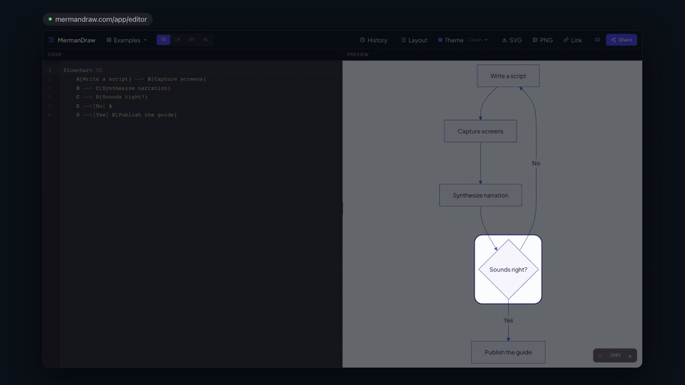
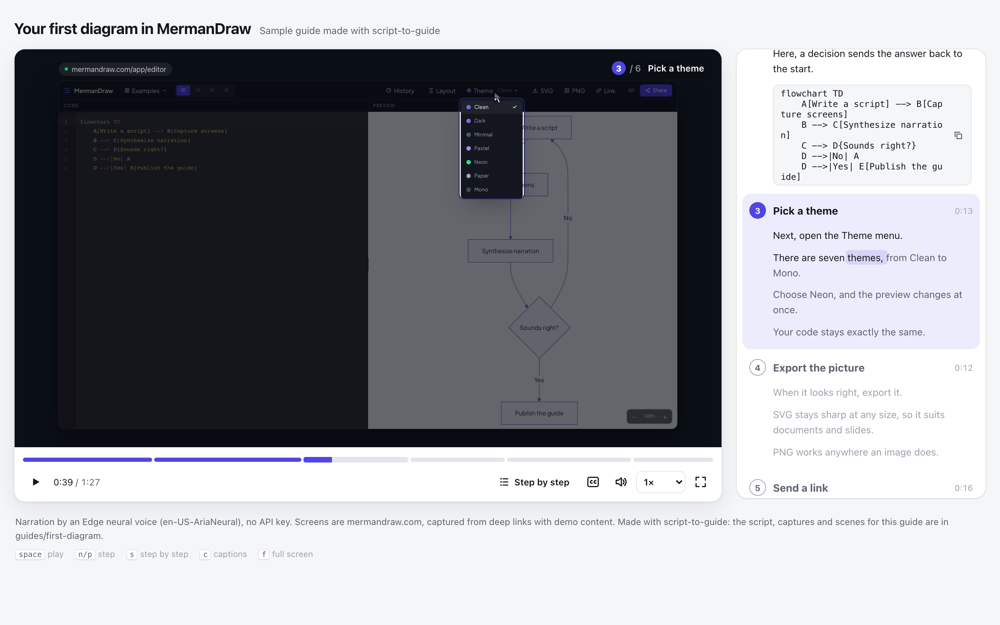

# script-to-guide

**Guides that talk.** Script + screenshots in, a narrated product walkthrough out. Ships as a small static web page (the sample is 1.4 MB), or as MP4 when you need a file.

A [Claude Code](https://claude.com/claude-code) / [Codex](https://openai.com/codex) skill. MIT.



**[Play the sample guide with sound](https://silvernine.github.io/script-to-guide/first-diagram/)** (1:29, English). It walks through [mermandraw.com](https://mermandraw.com): write the code, pick a theme, export, send a link. Everything that made it is in [`guides/first-diagram`](guides/first-diagram): a 197-word script, four captures, and one scene file where every highlight is `cue(scene, word)`. Nothing was placed on a timeline by hand. The same guide in Korean, with a Korean diagram and voice: **[Korean sample](https://silvernine.github.io/script-to-guide/first-diagram-ko/)** (1:38, [`guides/first-diagram-ko`](guides/first-diagram-ko)). Both samples are narrated with ElevenLabs voices (Max in English, Anna Kim in Korean, `eleven_v3`). Without a key, the same guides build with the default Edge voices; the voice is set in `tts` in `guide.json`.

[](https://silvernine.github.io/script-to-guide/first-diagram/)

Every motion it can make plays live in the [gallery](https://silvernine.github.io/script-to-guide/gallery/).

## What it does

You write the script. Each paragraph names the scene it belongs to and says what should be on screen. The agent captures your web app with a headless browser (or uses screenshots you bring), synthesizes the narration, and assembles the guide. Every motion on screen is cued to a word of the narration.

```
script.md  +  your web app (or screenshots)
        │
        ▼
  narration (TTS, word timestamps)  →  captions + scene timetable
        │
        ▼
  scenes: cue("install", "click Save")  →  spotlight, pin, zoom, cursor
        │
        ├──▶  dist/<name>/index.html   static page, searchable transcript, follow-along mode
        └──▶  dist/<name>.mp4 + .srt   when you need a file (YouTube, Slack, LMS)
```

## Why not just a video file

Product UI changes. A recorded video dies with it. A guide built from a script does not:

- **Cue, don't keyframe.** Nothing is placed on a timeline by hand. `cue(scene, word)` anchors every highlight, zoom and cursor move to the narration. Change a sentence, re-synthesize, and the screen follows.
- **Swap a screenshot, not a shoot.** When a button moves, replace one capture and rebuild. No re-recording, no re-encoding.
- **It is a web page.** The transcript is text you can select and search. Speed control and step jump are built in. Follow-along mode pauses after each step so the viewer can do it in their own app. Host the folder anywhere and embed it with an `<iframe>`.
- **Still a video when you need one.** The same timeline renders to MP4 by stepping the player frame by frame in a headless browser. No video framework in the dependency tree.
- **Checked narration.** The synthesized voice is transcribed back and compared with the script. Known mispronunciations from your dictionary are counted, and a similarity score shows when a take went wrong.

## Install

The quickest way is to hand your agent the link: "Install this skill: https://github.com/SilverNine/script-to-guide". Or pick one:

```bash
# Claude Code, Codex and other agents that read skills, via skills.sh
npx skills add SilverNine/script-to-guide

# Claude Code plugin
claude plugin marketplace add SilverNine/script-to-guide
claude plugin install script-to-guide@silvernine

# Codex (or Claude Code without the plugin system)
git clone https://github.com/SilverNine/script-to-guide.git ~/.script-to-guide
mkdir -p ~/.codex/skills ~/.claude/skills
ln -s ~/.script-to-guide ~/.codex/skills/script-to-guide
ln -s ~/.script-to-guide ~/.claude/skills/script-to-guide
```

Then ask your agent for a guide ("make a 2 minute guide for our signup flow"). On first use it runs `setup`, which installs the engine's Node packages, Playwright's Chromium (about 150 MB) and a Python venv inside the skill folder. The first narration check downloads a whisper model (about 490 MB for English, 570 MB for other languages).

You need macOS or Linux, Node 18+, Python 3.10+ (on Debian or Ubuntu also `python3-venv`) and ffmpeg. Windows is untested.

The skill folder is the engine only. Your guides live in your project under `guides/<name>/` and builds go to `dist/`, so updating the skill never touches your work. Add these to your project's `.gitignore`:

```
dist/
guides/*/takes/
```

## Without an agent

Every step is one command. Point `stg` at the engine: `~/.script-to-guide` for a clone, or `~/.claude/plugins/cache/silvernine/script-to-guide/<version>` for the plugin.

```bash
stg() { node ~/.script-to-guide/scripts/stg.mjs "$@"; }
stg setup                     # once, and after an update
stg doctor                    # what is installed and what is missing
stg new signup                # ./guides/signup/ from the sample, builds as is
stg synth signup              # narration, captions, scene timetable
stg verify signup             # transcribe it back and compare with the script
stg check signup              # type-check the scenes
stg build signup              # dist/signup/index.html
stg frames signup --at 0,450  # review stills
stg mp4 signup                # dist/signup.mp4 + .srt
```

## Embed

`dist/<name>/` is a static folder: `index.html`, one `app.js`, the captures and the narration. Upload it to any static host, then:

```html
<iframe src="https://docs.example.com/guides/signup/" title="Signup guide"
        style="width:100%;aspect-ratio:16/10;border:0" allow="fullscreen; clipboard-write"></iframe>
```

## What ships in this repo

| Layer | What it is |
|---|---|
| `SKILL.md` | The skill entry point. Picks a mode, says which reference to read, states the rules the agent must not break |
| `references/` | Pipeline stages and checkpoints, script format, narration rules, pronunciation dictionary, capture, final review, build and MP4 |
| `cards/` | 13 motion cards: spotlight, numbered pin, magnifier, cursor click, callout, type-in, screen swap, camera push-in, redact, title, chapter, step list, drawn dialog. Each has an intent, when to use and avoid it, a parameter table, known pitfalls and an example |
| `gallery/` | Every card playing live, rendered by the player's own runtime |
| `player/` | The player: a single-page React app bundled into one `app.js`. The clock is the audio position, so picture and sound cannot drift. Keyboard shortcuts, captions, follow-along mode, light and dark themes |
| `scripts/` | `stg.mjs`, the one entry point: setup, new guide, capture, TTS with word timestamps, transcription check, web build, MP4 render |
| `guides/first-diagram/` | One complete sample guide for a public app: script, pronunciation dictionary, captures with element boxes, scenes |
| `guides/first-diagram-ko/` | The same guide in Korean: Korean script with English UI names, a Korean pronunciation dictionary, Korean-diagram captures |

## Voices

Narration comes from a text-to-speech provider that returns word timestamps, so captions are the script word for word.

- **Edge** (default): Microsoft Edge neural voices through the [edge-tts](https://github.com/rany2/edge-tts) package. No API key. It uses an unofficial endpoint, so check whether its terms fit your use before you publish.
- **ElevenLabs**: set `ELEVENLABS_API_KEY`. The scripts never print the key. The sample guides use it.
- **Silent**: timing from text length and no audio, for layout work and CI.

The code is MIT. The voice output follows the terms of the provider you choose.

## License

MIT. See [LICENSE](LICENSE).
